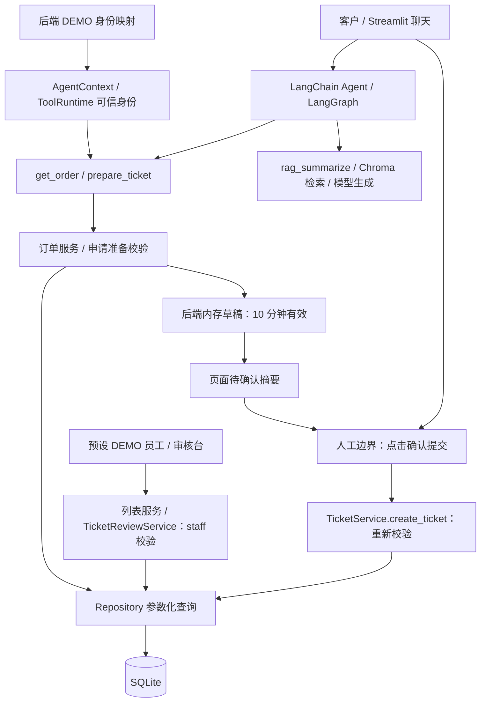

# ServicePilot AI

**ServicePilot AI** 是一个基于 Python、LangChain / LangGraph 和 Streamlit 构建的电商智能客服 Agent 系统，旨在探索大语言模型与实际业务系统的集成方式。

项目围绕电商订单查询与售后服务场景，结合 **Agent Tool Calling、RAG 知识库检索、数据库持久化和人工审核机制**，实现从自然语言交互到售后工单处理的完整业务流程。

系统采用分层架构，将大模型的意图理解与工具调度能力和后端确定性业务逻辑相结合，重点实现了订单归属校验、售后资格判断、用户确认、幂等控制、事务处理及审核权限管理，降低模型误操作对业务数据的影响。

目前项目已完成本地 MVP，支持虚构 DEMO 订单与售后流程演示，并通过 **538 项自动化测试**。系统尚未接入真实电商平台，不执行实际退款、支付或其他履约操作。

## 核心功能与能力边界

| 功能 | 实现与边界 |
| --- | --- |
| AI 订单查询 | `get_order(order_no)` 查询当前 DEMO 用户订单，返回状态、商品快照、金额、数量、时间和可申请售后类型。 |
| AI 售后准备 | `prepare_ticket(order_no, ticket_type, description)` 校验归属及资格，生成待确认摘要；此时不创建工单。 |
| 用户确认提交 | 页面“确认提交”按钮调用后端 `TicketService.create_ticket()`，创建 `pending_review` 工单；支持取消、过期及防重复提交。 |
| 员工审核台 | 启用的预设 DEMO 员工查看列表和详情，填写意见后批准或拒绝；保存审核记录，已审核工单仅可查看。 |
| RAG 检索 | 提供五份原创虚构电商客服 TXT，涵盖订单状态、退货、换货、维修和审核；显式导入 Chroma 后由 `rag_summarize` 检索并依据资料回答，空检索不调用 RAG 生成模型。 |
| 业务响应保护 | 对订单及售后工具失败结果生成确定性安全说明，避免模型补充未经证实的拒绝原因；普通聊天与成功结果不走该失败替换逻辑。 |

**Agent 默认仅注册三个工具：`get_order`、`prepare_ticket`、`rag_summarize`。**
前两项为业务工具，第三项为知识检索工具。天气、定位、随机身份、随机月份和报告功能已移除。
`create_ticket`、`review_ticket` 均为后端服务方法，不注册给 Agent。

## 技术栈

- **Python 3.13.9**：当前推荐并验证的 Windows 运行版本。
- **LangChain 1.4.2 / LangGraph 1.2.12**：`create_agent`、ToolRuntime、可信 Context 及流式执行接口。
- **Streamlit 1.65.0**：客服聊天、确认按钮和独立员工审核页面。
- **SQLAlchemy 2.1.6 / SQLite**：User、Product、Order、Ticket，约束、事务及 UTC 时间处理。
- **Chroma / LangChain Chroma / DashScope**：向量存储；聊天通过 `init_chat_model` 和 OpenAI provider 连接 DashScope 兼容接口，Embedding 保留 `DashScopeEmbeddings`。
- **pytest**：数据库、业务服务、工具集成、响应保护和页面事件的离线测试。

完整版本见 [requirements.txt](app/requirements.txt)。
默认模型为 `qwen-max`、Embedding 为 `text-embedding-v4`，配置见
[rag.yml](app/config/rag.yml)。
聊天兼容地址可通过 `DASHSCOPE_CHAT_BASE_URL` 设置，详见 [环境配置](app/ENV_SETUP.md)。

## 系统架构



模型可见订单号和申请内容，身份由后端注入；模型不能指定 `current_user_id`、
`confirmed` 或 `idempotency_key`。人工确认和审核均在 Agent 之外执行。

## 快速开始（Windows PowerShell）

### 1. 创建独立环境并安装依赖

以下从**仓库根目录**开始，适用于新克隆；如已有 `.venv`，不要覆盖，先选定现有环境或另建独立环境。
先确认 `python --version` 为推荐的 3.13.9，再执行：

```powershell
Set-Location '.\app'
python --version
python -m venv .venv
& '.\.venv\Scripts\python.exe' -m pip install -r requirements.txt
& '.\.venv\Scripts\python.exe' -m pip check
```

原 `requirements-business.txt` 用于独立业务层，`requirements-agent-test.txt` 用于离线
Agent 测试依赖；新安装完整应用请使用 `requirements.txt`。无需激活脚本即可使用上述解释器。

### 2. 设置模型环境变量并启动

在**同一个 PowerShell 窗口**输入自己的 DashScope 密钥，不把密钥写进命令字面量：

```powershell
$dashscopeSecret = Read-Host '请输入 DashScope API Key（输入不回显）' -AsSecureString
$env:DASHSCOPE_API_KEY = [System.Net.NetworkCredential]::new('', $dashscopeSecret).Password
Remove-Variable dashscopeSecret
& '.\.venv\Scripts\python.exe' -c "import os; print('Key configured:', bool(os.getenv('DASHSCOPE_API_KEY', '').strip()))"
& '.\.venv\Scripts\python.exe' -m streamlit run app.py --server.address 127.0.0.1
```

浏览器打开终端提示的本地地址（默认 `http://127.0.0.1:8501/`）。客服首页标题为
“ServicePilot AI｜智能客服”，员工页面标题为“ServicePilot AI｜员工审核台”；
两页浏览器标签与侧边栏品牌均为“ServicePilot AI”，员工导航入口保持 `Staff Review`。
首次客服提问会初始化 Agent；首页能打开不代表密钥有效。

**项目不会自动加载 `.env`。** [.env.example](app/.env.example) 只是示例，
占位值不是可用密钥。新开独立终端需重新设置临时变量，已启动的服务需重启才能读取新值。
详见 [ENV_SETUP.md](app/ENV_SETUP.md)。真实对话和向量化需要有效 API 权限及额度。

### 3. 初始化 DEMO 并演示

1. 客服侧边栏勾选“启用 DEMO 订单查询”，点击“初始化独立 DEMO 数据库”，选择预设用户 A 或 B。
2. 在聊天中查询自己的订单，或按下表选择符合资格的售后订单。
3. 例如用户 A 输入：`请为订单 DEMO-AFTERSALE-A 准备换货申请，类型 exchange_request，问题描述：虚构商品按键失灵。`
4. 核对摘要后点击页面“确认提交”；也可点击“取消申请”。**不要用客服聊天中的“确认”代替按钮。**
5. 从侧边栏进入“Staff Review”（员工审核台），启用本地 DEMO，点击“初始化 / 补充 DEMO 员工”，选择预设虚构员工。
6. 选择新工单，填写审核意见，点击“批准”或“拒绝”；在“全部”中查看已审核记录。

| 用户 | 订单号 | 初始状态 | 可申请类型 |
| --- | --- | --- | --- |
| A | `DEMO-ORDER-A` | `pending_payment` | 无 |
| B | `DEMO-ORDER-B` | `pending_payment` | 无 |
| A | `DEMO-AFTERSALE-A` | `completed` | 退货、换货、维修 |
| B | `DEMO-AFTERSALE-B` | `shipped` | 退货、换货、维修 |

两个页面使用同一个 `app/servicepilot_demo.sqlite3`。初始化可重复执行，
只补充缺失的已验证虚构记录；不重置订单、不删除已有工单，也不重新启用停用员工。
重复演示遇到活跃工单时，可选择尚无活跃工单的用户/类型，不要删除数据库来绕过约束。

### 4. 运行自动化测试

停止服务后，仍在 `app` 目录执行：

```powershell
& '.\.venv\Scripts\python.exe' -m pytest tests -q
```

测试使用独立临时 SQLite、临时 Chroma 和虚构记录，RAG 测试使用离线 Embedding；
不需要真实模型密钥，不访问用户已有数据库或向量库。

## 售后流程与安全设计

`prepare_ticket` → 后端校验并生成草稿 → 用户点击确认 → `create_ticket`
→ `pending_review` → 员工审核 → `approved` / `rejected`。
**批准仅代表申请获得批准，不代表退款或其他履约已经执行。**

- **订单归属**：订单号和可信用户 ID 在 SQL 中联合过滤；不存在和无权访问统一返回 `ORDER_NOT_FOUND`。
- **员工权限**：列表、详情、审核写入各自检查数据库账号启用状态及 `staff` 角色，不能只靠隐藏按钮。
- **人工确认**：草稿及稳定幂等键保存在后端；10 分钟过期。取消、切换用户或发送任何新客服聊天消息都会使旧草稿失效。
- **幂等与重复申请**：用户与幂等键唯一，指纹识别不同内容；活跃工单条件唯一索引阻止同用户、订单、类型的重复申请。
- **事务与并发审核**：SQLite `BEGIN IMMEDIATE` 配合待审核状态及空审核字段的条件更新，仅一名审核员能确定结果；重复审核不覆盖记录。
- **错误边界**：业务返回 `ok/data/error`；明确工具失败由输出保护生成安全说明。模型连接或流式失败显示统一提示，不把不完整输出保存为成功回答，也不自动重试工具写入。

详细字段、约束、资格规则和流程见 [business/README.md](app/business/README.md)。

## RAG：虚构知识库与可复现导入

[sample_knowledge/](app/sample_knowledge) 提供五份原创、可公开分发的 ServicePilot
DEMO TXT：订单状态、退货、换货、维修与审核流程。知识只说明虚构规则，不代表实时订单或真实平台政策。

在已安装依赖并设置 `DASHSCOPE_API_KEY` 的环境中，从 `app/` 执行：

```powershell
& '.\.venv\Scripts\python.exe' scripts/build_knowledge_base.py --help
& '.\.venv\Scripts\python.exe' scripts/build_knowledge_base.py --yes
```

**`--yes` 表示确认调用可能收费的 DashScope Embedding API。** 未确认、缺少密钥或没有知识文件时拒绝导入。
CLI 默认读取示例目录，复用 [vector_store.py](app/rag/vector_store.py) 的加载、MD5、
分片和 Chroma 实现，使用 [chroma.yml](app/config/chroma.yml) 的 collection `agent`
及 `rag/chroma_db` 路径。普通 Streamlit 启动不自动导入。

TXT/PDF 经 `RecursiveCharacterTextSplitter` 切分（200 字符、重叠20），Embedding 后持久化。
稳定分片 ID 配合当前 collection 核验，使重复导入和旁路 MD5 写入失败后的重试不会重复插入；
不清空或覆盖用户已有向量数据。修改源文件采用追加，不自动删除旧版本。

`rag_summarize` 检索 top-3 片段，将内容和来源元数据传入原 Prompt。零文档时直接返回无资料说明，
不调用 RAG 生成模型；检索异常、生成异常各有安全提示。日志只保留阶段和数量等信息。

示例文件和 CLI 可被 Git 跟踪；本地 `data/`、生成的 Chroma 和 MD5 记录仍被忽略。
检索相关性、引用准确性和真实模型效果仍需另行评测。详见 [知识库使用说明](app/KNOWLEDGE_BASE.md)。

## 验证范围

- **最新完整离线测试：538 passed, 1 warning**。包含 ORM 约束、UTC、订单隔离、幂等、事务回滚、审核权限、双审核员竞争、工具参数隔离、草稿有效期、页面事件、业务响应保护、RAG 边界和示例导入，以及统一模型初始化、Tool Calling 和流式适配测试。现有一项 `langchain-community` 弃用警告，不是测试失败。
- **真实浏览器人工验收**：用户操作真实页面、调用已配置模型；完成售后准备、按钮确认、员工批准和拒绝、刷新保留结果，并由只读数据库查询和工具日志核对。
- **主要由离线测试覆盖**：伪造工具参数、停用账号、并发竞争、数据库故障、流式中断和不可靠模型输出。测试使用 Mock / 假模型，不代表真实模型在所有输入下都可靠。
- **RAG 验证边界**：示例知识库导入、去重和检索使用临时真实 Chroma 与离线 Embedding 验证，未调用真实 DashScope API；尚未完成示例知识库的真实 Embedding 导入及生成效果端到端验收。
- **干净环境验证**：Windows + CPython 3.13.9 安装依赖成功、`pip check` 无冲突，完整测试通过；客服和审核页面通过 Streamlit AppTest 启动加载检查，未调用付费 API。

以上不代表生产部署、负载、安全审计或完整 RAG 效果评测。人工浏览器验收也不等于所有故障场景均已在真实页面复现。

## 目录与当前限制

```text
app/
  app.py / pages/        客服和员工页面
  agent/                Agent、可信 Context、工具与输出保护
  business/             ORM、Repository、Service、DEMO 和确认流程
  rag/ / model/         检索链、向量库及模型适配
  config/ / prompts/    配置与提示词
  tests/                离线自动化测试
```

- **仅本地 DEMO，无真实登录认证。** 任何能访问员工页面的人都能选择演示员工，不应公开部署。
- 没有真实退款、支付、换货、维修执行，也没有接入真实电商订单系统。
- 草稿和会话状态依赖单进程内存，重启会丢失未提交申请；已提交工单保存在 SQLite。
- 所有启用的 `staff` 均可审核，未实现细粒度权限；列表最多 100 条，尚无分页。
- 依赖验证范围为 Windows + Python 3.13.9；间接依赖未全部锁定，其他平台未验证，尚未部署生产环境。
- RAG 样例仅用于本地演示，尚无检索相关性或真实模型效果评测；不要导入真实敏感资料，文件修改也不会自动移除旧索引版本。

## 项目来源

项目由黑马程序员 LangChain / LangGraph 教程练习逐步扩展，面向 AI 应用开发学习和实习作品展示。
部分基础结构延续教程学习基线，后续扩展了电商业务、人工确认、审核及工程化测试；
本项目不宣称所有代码均从零独立编写。来源说明不等同于第三方许可证明，相关授权仍需后续核对。
